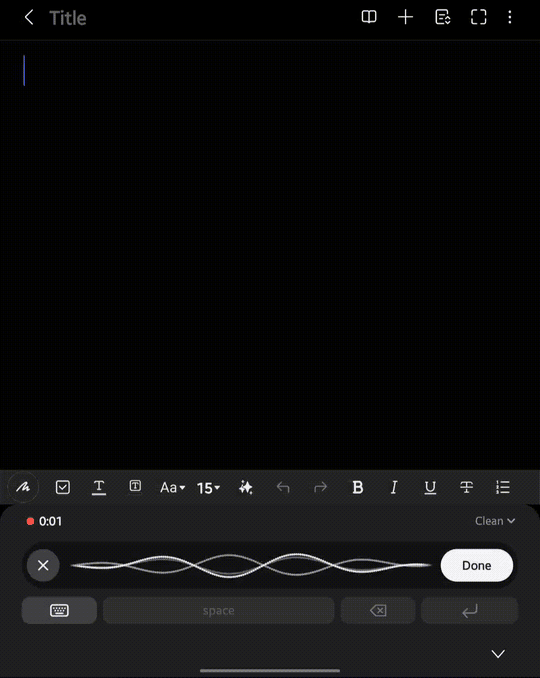
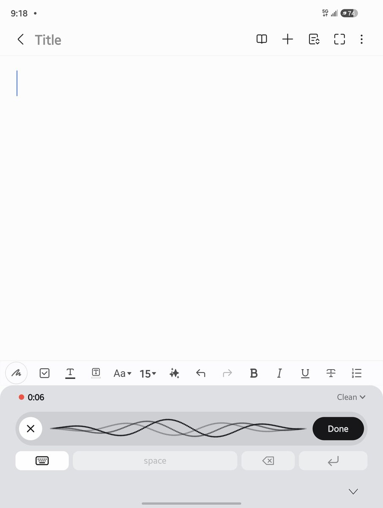
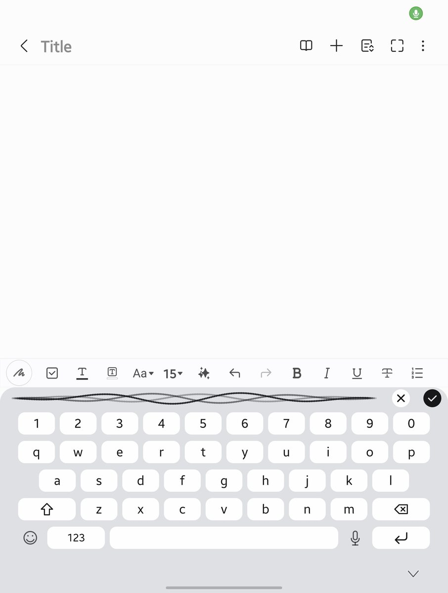
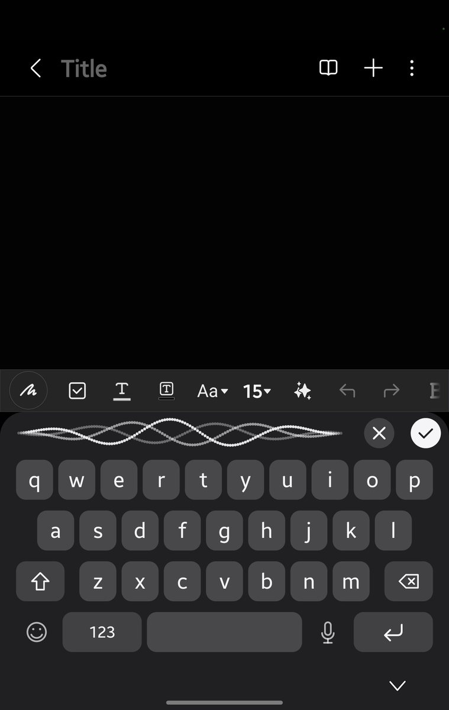
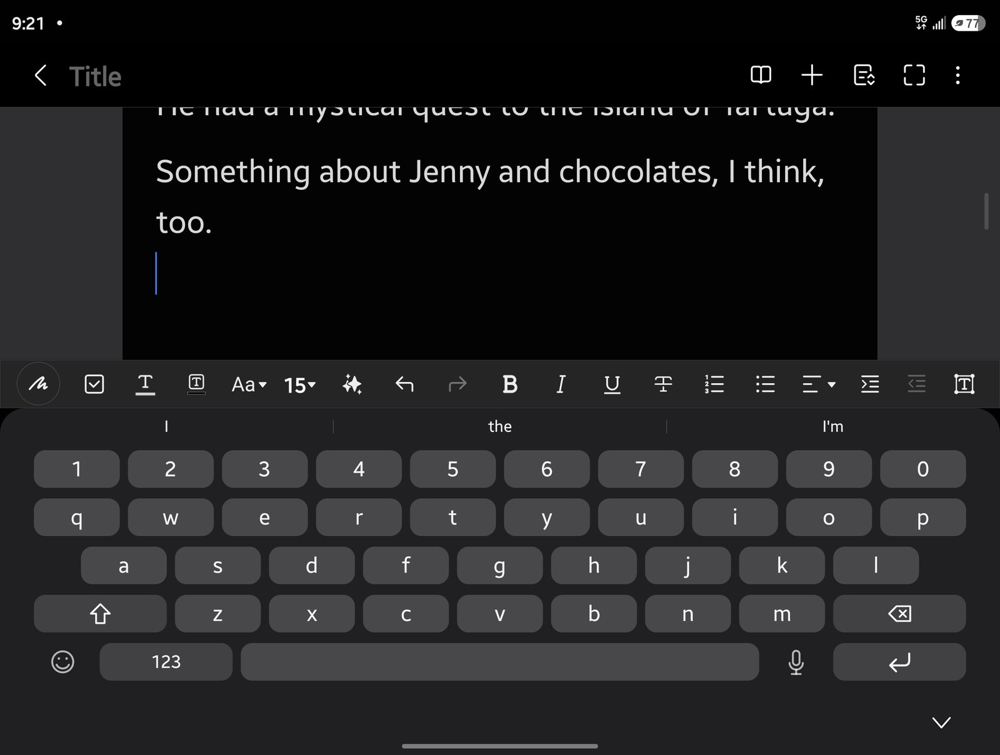

<p align="center">
  
</p>

<h1 align="center">SoftKeys</h1>

<p align="center">
  <strong>An iOS-inspired keyboard for Android.</strong><br>
  Local autocorrect, glide typing, on-device dictation, and layouts for phones and foldables.
</p>

<p align="center">
  <a href="https://github.com/Public-Bytes/softkeys/releases/latest"><strong>Download the APK</strong></a> ·
  <a href="#install">Install</a> ·
  <a href="CHANGELOG.md">Release notes</a> ·
  <a href="#privacy-at-a-glance">Privacy</a> ·
  <a href="https://github.com/Public-Bytes/softkeys/issues/new/choose">Report a problem</a> ·
  <a href="CONTRIBUTING.md">Contributing</a>
</p>

<p align="center">
  
</p>

---

SoftKeys brings the look and feel of the iPhone keyboard to Android: continuous key rows, one wide space bar, and a calm, familiar layout. Typing, autocorrect, and glide typing run entirely on the phone, and dictation can too.

SoftKeys is free and open source under the [MIT License](LICENSE). It is an independent project and is not affiliated with Apple or Google.

## Highlights

- An iOS-style layout with continuous key rows, one space bar, and Reference, Dark, Lavender, and System themes. Wide displays and unfolded phones get a wider layout with a number row.
- Autocorrect, suggestions, and glide typing that run on the phone from a bundled English dictionary. Typed text is never sent over the network.
- Cursor control on the space bar, accents on held letters, an emoji picker with search, a Paste chip for recently copied text, and adjustable key vibration.
- A dictation keyboard. Speech can be recognized on the phone with a model you download once, so audio never leaves the phone, or by your phone's speech recognition service.

## Gallery

Real screenshots from an Android phone, in light and dark, upright and sideways.

<table>
  <tr>
    <td align="center" width="33%">
      <br>
      <sub><b>Dictation keyboard</b><br>The waves rise and move faster while you speak</sub>
    </td>
    <td align="center" width="33%">
      <br>
      <sub><b>Dictate with the keys showing</b><br>Tap the microphone in the suggestion bar</sub>
    </td>
    <td align="center" width="33%">
      <br>
      <sub><b>Dark</b><br>The same recording bar in the dark theme</sub>
    </td>
  </tr>
  <tr>
    <td align="center" colspan="3">
      <br>
      <sub><b>Landscape</b><br>The full layout stretches across the wider screen</sub>
    </td>
  </tr>
</table>

The default Reference theme uses light gray with white keys on narrow displays and lavender on wide displays. Both layouts use continuous rows with one space bar. Wide displays include a dedicated number row by default. Enter sits at the far right of the bottom row, with the microphone beside Space. Dark, Lavender, and System themes are also available.

## Requirements

- Android 8.0 (API level 26) or later.
- English. The dictionary and the speech models are English only.
- For on-device dictation: a 64-bit ARM phone, and free storage for one or both speech models (137 MB for Fast, 661 MB for High accuracy). The High accuracy model used up to about 1.4 GB of memory in desktop measurements, so phones with little memory may close SoftKeys while it transcribes. The phone speech service works without a download.

## Install

SoftKeys is installed from its APK file. It is not on Google Play.

1. On your Android phone, open the [latest release](https://github.com/Public-Bytes/softkeys/releases/latest) and download the `SoftKeys` APK file (about 10 MB).
2. Open the downloaded file. If Android asks, allow your browser or file manager to install apps. Google Play Protect may show a warning because the app does not come from Google Play.
3. Open SoftKeys, choose **Enable SoftKeys**, then choose **Choose SoftKeys**.
4. Open any text field to start typing, or use the sample field in the SoftKeys app.
5. Optional: to use on-device dictation, open **Dictation** in SoftKeys settings and download a speech model.

Each release lists the APK's SHA-256 checksum in a `.sha256` file, so you can check the download. Every release is signed with the same certificate, so a newer APK installs over an older one and keeps your settings and learned words. To remove SoftKeys, uninstall it like any other app.

## Privacy at a glance

- What you type stays on the phone. SoftKeys does not send typed text anywhere and does not save it, apart from single words you choose to keep after a correction.
- No accounts, ads, analytics, or tracking.
- The network is used only when you choose to download a speech model or the smart cleanup model, from fixed public files on Hugging Face.
- On-device dictation keeps audio in memory on the phone. The phone speech service, if you choose it, may send audio to its provider.
- Permissions: vibration, microphone (asked the first time you dictate), and internet (model downloads only). No contacts, location, or storage permissions.

[Privacy and permissions](#privacy-and-permissions) has the details.

## Typing

| Feature | How to use it |
| --- | --- |
| Autocorrect | Type a word and enter a space or punctuation. The highlighted middle suggestion shows the word that will be inserted. Tap your own spelling, shown in quotes on the left, to keep it. Press Backspace immediately after a correction to restore the original spelling. |
| Glide typing | Slide through the letters of a word and lift to insert it. Tap a suggestion to choose another match. Press Backspace right after a glide to remove the whole word. The trail is a translucent stroke that is widest under your finger and narrows behind it. |
| Numbers and symbols | Tap 123, type, and enter a space to return to the letters. An apostrophe also returns to the letters. To type one symbol, hold 123, slide to the symbol, and lift. |
| Cursor control | Hold Space, then drag left or right. Drag up or down to move between lines in multiline editors. |
| Accents | Hold a letter, then choose a variant. |
| Capitals | Tap Shift for uppercase. Double-tap or hold Shift for Caps Lock. |
| Repeated deletion | Hold Backspace. It removes characters first and then whole words. |
| Clipboard suggestion | Tap the Paste chip above the keys to insert recently copied text. Tap its close button to dismiss it. |
| Emoji | Open the emoji picker for categories, search, and recent selections. Drag sideways to slide between pages. Hold an emoji with a dot below it for variants. |
| Dictation | Tap the microphone to switch to the dictation keyboard and start recording. Tap Done to insert the text, or × to discard it. Tap the keyboard button to bring the keys back. |

Autocorrect, suggestions, and glide decoding use a bundled English dictionary with contractions, common names, and common texting and technology words. Autocorrect uses where each tap landed, so a tap near the edge of a key can be read as the neighboring letter. Recognized words, acronyms, and mixed case text are preserved. Short words that the dictionary does not hold are changed only when the evidence is strong. URL and path syntax stays literal, while ordinary search words can be corrected.

SoftKeys stops correcting a word after you keep your own spelling. Restoring a spelling with Backspace keeps that word until the keyboard restarts. Restoring it a second time, or tapping your spelling in the suggestions, saves the word on the phone. Saved words also appear in suggestions and glide results.

A glide or a chosen suggestion adds a space after the word. A punctuation mark typed next replaces that space, and a glide after punctuation starts with a space.

Glide entry and suggestions remain available in email fields and recognized terminal editors. Automatic word replacement stays off in those fields. Password fields keep predictions disabled. Recognized terminal command fields marked as visible passwords have a specific exception unless their hints identify a password or secret.

## Dictation

Tap the microphone on the keys to switch to the dictation keyboard. The letter keys, numbers, and suggestions are replaced by a shorter panel, and recording starts at once. The panel shows a red dot with a timer, dotted waves that move with your voice, × to discard the recording, and Done. Tap Done, and the text is inserted and the panel returns to its idle state. Tap **Dictate** to record again. The bottom row of the panel holds the keyboard button, Space, Delete, and Return. Return runs the field's action, such as Send or Search, when it has one.

To dictate without leaving the keys, tap the microphone at the right end of the suggestion bar. The suggestion bar turns into the waves with × and ✓, and the keys stay usable. Tap ✓ to insert the text, or start typing, and SoftKeys inserts the text first and your typing after it. After the text goes in, an Undo dictation button in the suggestion bar removes it until you type something else.

Tap the keyboard button at the left end of the bottom row, beside Space, to bring the keys back. If you were recording, SoftKeys finishes the recording and inserts the text, and anything you type meanwhile follows it. SoftKeys remembers which keyboard you used last, so other text fields and the next time the keyboard opens show the dictation keyboard until you tap the keyboard button. Password, PIN, number, phone, date, and private browsing fields always show the keys and never record, and they do not change that choice.

The first recording asks for microphone permission. After granting access, return to your text field and tap Dictate. You can also grant permission through Microphone access in SoftKeys settings. Dictation stays active through pauses until you tap Done. There is no time limit. Moving the cursor from the app, hiding the keyboard, or changing fields discards an open recording.

The style button at the top right switches between **Clean** and **Verbatim**. Clean removes fillers and repeated words, takes back what you correct, writes numbers and web addresses as text, and applies spoken punctuation and your word replacements. Verbatim keeps every word that the model heard and fixes only spacing and capitals. Styles apply to on-device dictation.

### Engines and models

Choose the engine in SoftKeys settings. **Phone speech service** is the default and needs no download. **On-device (Hex-style)** recognizes speech on the phone with [sherpa-onnx](https://github.com/k2-fsa/sherpa-onnx), and the audio never leaves the phone. It offers two models, which you download once from Hugging Face in settings. SoftKeys checks the size and SHA-256 of each file before using it.

| Model | Download | How it works |
| --- | --- | --- |
| **High accuracy** (recommended), NVIDIA Parakeet TDT 0.6B v2 | 661 MB | Transcribes the whole recording after Done, as Hex does. It makes the fewest mistakes and writes punctuation and capitals. |
| **Fast**, NVIDIA FastConformer streaming | 137 MB | Transcribes while you speak, so Done is almost instant. It makes more mistakes and writes no punctuation. |

[docs/dictation-benchmark.md](docs/dictation-benchmark.md) lists the measured accuracy and speed. The measurements were made on a Linux desktop, not on a phone. SoftKeys starts loading the model when the dictation keyboard appears and keeps it loaded while that keyboard stays open, and the microphone starts before loading finishes. High accuracy used about 0.9 GB of memory after loading and up to about 1.4 GB while transcribing in the desktop measurements, so Android may close SoftKeys to free memory on phones with little memory. If the chosen model is not downloaded, SoftKeys uses the other downloaded model or the phone speech service. On-device dictation needs a 64-bit ARM phone.

The Clean style applies these rules before the text is inserted:

- It removes "um", "uh", "er", and similar sounds, and it removes "you know" and "like" when commas set them apart. It also removes stutters and repeated words, such as "I I think" or "the the". Repeats that are often deliberate, such as "very very" and number sequences, are kept.
- It turns spoken "comma", "period", "question mark", "exclamation point", "colon", "new line", and "new paragraph" into punctuation. Turn off **Spoken punctuation** to keep these words. "Period" stays a word in phrases such as "a period of time".
- It applies your **Word replacements**, one rule per line, such as `soft keys => SoftKeys`. A rule with nothing after the arrow removes the words. A rule's written word, or a line with only one word such as `Kaczmarek`, also fixes other words that sound like it, so one rule covers the different ways the model misspells a name. Known English words are never changed this way.
- It takes back what you correct. If you say "the meeting is Monday, actually wait, the meeting is Tuesday", only "the meeting is Tuesday" is inserted. The phrases include "actually wait", "no wait", "no sorry", "make that", "I meant", "never mind", "on second thought", "my mistake", "ignore that", "I mean", "or rather", and a lone "wait", "actually", or "sorry". "Scratch that" removes the sentence before it. Phrases that are also ordinary English, such as "make that" or "sorry", only act after a pause and when what follows clearly matches what came before, such as "I like tea, wait, I like coffee" or "500 dollars, actually 450 dollars", because people also say them in ordinary speech. The model often writes a quick "wait" as "weight" or "wheat", so those words count too, but only in the same repeated pattern.
- It writes numbers as digits, such as "6'2\"", "120 pounds", "$20.50", "50%", "3:30", "2026", and "555-1212". A number from zero to nine stays a word unless a unit follows it, so "one time" and "the two of us" stay as they are.
- It formats spoken lists. Say "first", "second", "one", "two" with a pause after each, "number one", "number two", or "bullet" before each item, and each item goes on its own line. A list needs at least two markers. Turn off **Format lists** to keep the words as spoken.
- It writes spoken web addresses as text, so "google dot com" becomes "google.com", and "my email is name at gmail dot com" becomes "name@gmail.com".
- It fixes spacing around punctuation and capitalizes sentences and the word "I".

Both styles start the text with a lowercase letter when the cursor is in the middle of a sentence, unless the first word is "I" or has other capitals. A name at that position also loses its capital.

When the phone speech service is used on Android 13 and later, SoftKeys supplies a continuous audio stream to providers that support segmented recognition. Older Android versions and providers that end each request use automatically repeated recognition requests, which can have brief gaps between requests. Speech recognition depends on the service installed on your phone and its available English (US) language support. The service may use the network or process audio locally. SoftKeys keeps its own keyboard visible and does not open the provider's voice keyboard.

If no engine can run, the panel says so and offers a button that opens SoftKeys settings. The keyboard button still brings the keys back.

## Smart cleanup

Smart cleanup is an optional extra step for on-device dictation in the Clean style, and it is off by default. It runs Handy Editor 350M, a small language model trained to remove the words a speaker takes back, such as "send it to the platform team, no sorry, to the support team". The model is a 229 MB download from Hugging Face, and it runs on the phone, so the text never leaves it. It needs a 64-bit ARM processor with dot product instructions, which most phones from 2018 on have.

The Clean rules run before the model and after it. Before, they remove fillers and the corrections they can find, and the model gets lowercase words with no punctuation, the form it was trained on. After, they write numbers, web addresses, lists, and capitals. SoftKeys accepts the model's edit only when it removes words and changes punctuation and capitals. If the edit adds or changes a word, or removes text with no correction phrase near it, SoftKeys uses the rules-only text for that part. On 300 test sentences with a correction phrase from the Handy dictation-editing corpus, the rules alone got 99 right and smart cleanup got 155 right. Neither changed any of 153 sentences that needed no change. Smart cleanup adds a short wait after Done.

## Settings

Open SoftKeys to change settings. They are grouped in cards: Setup, Try it, Appearance, Typing, Dictation, Dictation style, Custom vocabulary, and About. Dictation style has switches for spoken punctuation, list formatting, the final period, and lowercase. **Custom vocabulary** is a list of names and terms. Add one in the field at the bottom, and remove one with ×. Each entry fixes its spelling and capitals, so "testflight" becomes TestFlight and "swift ui" becomes SwiftUI, and a name of 4 or more letters also fixes words that sound like it. **Word replacements** below it takes `spoken => written` rules for anything else. **Reset learned words** removes the words that SoftKeys saved after you kept your own spelling.

Open **Keypress vibration** to choose a duration from 1 to 100 ms using a slider or an exact number, including 2 ms. Moving the slider previews the vibration when Haptic feedback is on. Save keeps the value, Cancel preserves the previous value, and Default selects the existing 12 ms default. Hold feedback adjusts with the chosen duration.

Clipboard suggestions use the time the text was copied and expire after two minutes. A suggestion disappears when pasted, dismissed, or edited text is entered. The same item stays dismissed until a new item is copied, even when another editor opens. Suggestions stay out of password fields and do not preview clips marked sensitive by the copying app. No clipboard history is saved, and dismissing a suggestion leaves Android's clipboard unchanged.

The **Tablet number row** switch controls the dedicated digits on wide displays, including unfolded phones. It is enabled by default and does not add a row to narrow phone layouts. The row stays visible when switching between letters and symbols.

Touch and hold duration defaults to **300 ms**. Set it from 150 to 1000 ms in 25 ms steps. The setting applies to accents, emoji variants, cursor control, held Shift, and repeated deletion. Turning off automatic capitalization leaves manual Shift and Caps Lock available.

<details>
<summary>View the vibration and clipboard controls</summary>

<p>
  
  
</p>

</details>

## Privacy and permissions

SoftKeys does not send typed text over the network, and it does not save what you type. The exception is the list of learned words, which holds single words that you chose to keep after a correction. The list is saved on the phone, never includes text from password fields, and can be cleared with Reset learned words. Keyboard settings and recent emoji selections are also saved locally. The keyboard reads nearby editor text to provide suggestions and corrections. When Clipboard suggestions is enabled, it also reads recent copied text for the Paste chip and keeps the eligible item only in memory until it is dismissed or expires. This feature does not save a clipboard history.

The app requests Android's normal `VIBRATE` permission for haptic feedback, optional `RECORD_AUDIO` permission for dictation, and `INTERNET` permission. SoftKeys uses the network only when you choose to download a speech model. The download fetches fixed public model files from Hugging Face over HTTPS and sends no audio, text, or device details. The models are saved in app storage that is excluded from backups. SoftKeys has no contacts or storage permissions.

On-device dictation keeps microphone audio in memory on the phone and never sends it anywhere. The phone speech service receives microphone audio and may send it to its provider. SoftKeys does not save microphone audio or transcripts to files. Word replacement rules are saved in SoftKeys settings on the phone.

## Build

Use Java 17, Android SDK platform 36, and the included Gradle wrapper. Set `ANDROID_HOME`, or put your SDK path in an untracked `local.properties` file.

```sh
git clone https://github.com/Public-Bytes/softkeys.git
cd softkeys
./gradlew :app:assembleRelease --console=plain
```

The build downloads the sherpa-onnx 2.0.2 Android library and the llama.cpp b9893 source from GitHub once and checks their SHA-256, so the first build needs network access. Building llama.cpp needs Android NDK 29.0.14206865 and the SDK CMake 3.31.6, which the Android Gradle Plugin can install. The unsigned APK is written to `app/build/outputs/apk/release/app-release-unsigned.apk`. GitHub Actions checks the unsigned release build. Manual workflow runs can also upload the unsigned APK when Actions storage is available. Installable signed updates are attached to Releases. Signing keys stay outside the repository and GitHub Actions.

See [Development](docs/development.md) for the source layout, the sample editor, and release guidance.

## Current limits

Glide decoding and autocorrect judge each word alone. They do not use the words before it, so words with the same or nearly the same path, such as "to" and "too" or "has" and "had", are chosen by how common they are. On recorded swipes from the public How We Swipe dataset, the first choice matched the intended word in about 84 of 100 swipes, and the intended word was among the three choices in about 92 of 100. Cursor control depends on the editor's handling of Android arrow keys. Custom editors can behave differently from standard Android text fields.

On-device dictation recognizes English only. The Fast model does not add punctuation by itself, so without spoken punctuation a long dictation becomes one sentence. The High accuracy model writes punctuation and capitals. The cleanup rules use word lists and pauses, so some fillers stay and some deliberate repeats can be removed. On-device accuracy was not measured on a phone.

Emoji use the device's Android font, so artwork and available characters depend on Android. Apple emoji artwork is not included. Haptic feedback depends on physical device hardware and system restrictions.

SoftKeys is a small project. Each release is checked with offline tests and benchmarks and a build in GitHub Actions, but it is not tested on every phone, Android version, or app. If something looks or behaves wrong on your phone, please [open an issue](https://github.com/Public-Bytes/softkeys/issues/new/choose) with your phone model and Android version.

## Data and licenses

The English dictionary is derived from Hermit Dave's [FrequencyWords English 2018 list](https://github.com/hermitdave/FrequencyWords), based on OpenSubtitles 2018. It retains lowercase ASCII words and contractions up to 26 characters, with tab-separated counts. The modified dictionary is distributed under [CC BY-SA 4.0](app/src/main/assets/licenses/CC-BY-SA-4.0.txt). The source list splits contractions at the apostrophe, so `lexicon.tsv` adds contractions with estimated counts, capital letters for common names, and common texting and technology words. It also removes the leftover fragments and some misspellings. `lexicon.tsv` was written for SoftKeys.

On-device dictation uses [sherpa-onnx](https://github.com/k2-fsa/sherpa-onnx) 2.0.2 under the [Apache License 2.0](app/src/main/assets/licenses/Apache-2.0.txt). Its Android library links ONNX Runtime and other components under the MIT, Apache 2.0, BSD 3-Clause, and Mozilla Public License 2.0 licenses, which are listed in NOTICE.txt. The two speech models are downloaded separately and are not part of the app: NVIDIA's [Parakeet TDT 0.6B v2](https://huggingface.co/nvidia/parakeet-tdt-0.6b-v2) (High accuracy) and [stt_en_fastconformer_hybrid_large_streaming_multi](https://huggingface.co/nvidia/stt_en_fastconformer_hybrid_large_streaming_multi) (Fast), both converted to ONNX by the sherpa-onnx project and licensed under [CC BY 4.0](app/src/main/assets/licenses/CC-BY-4.0.txt). The cleanup rules were written for SoftKeys after reading the cleanup steps in [Hex](https://github.com/anomalyco/hex), which is MIT licensed. No Hex code is included.

Emoji names and sequences come from [Unicode Emoji 16.0](https://www.unicode.org/Public/emoji/16.0/emoji-test.txt), under the [Unicode License v3](app/src/main/assets/licenses/Unicode-3.0.txt). Attribution and notices are bundled in [NOTICE.txt](app/src/main/assets/licenses/NOTICE.txt) and are available in the app's license screen.

## License

The SoftKeys source code is released under the [MIT License](LICENSE). The bundled dictionary, emoji data, and speech library, and the downloadable speech models, keep their own licenses, listed above and in [NOTICE.txt](app/src/main/assets/licenses/NOTICE.txt).
