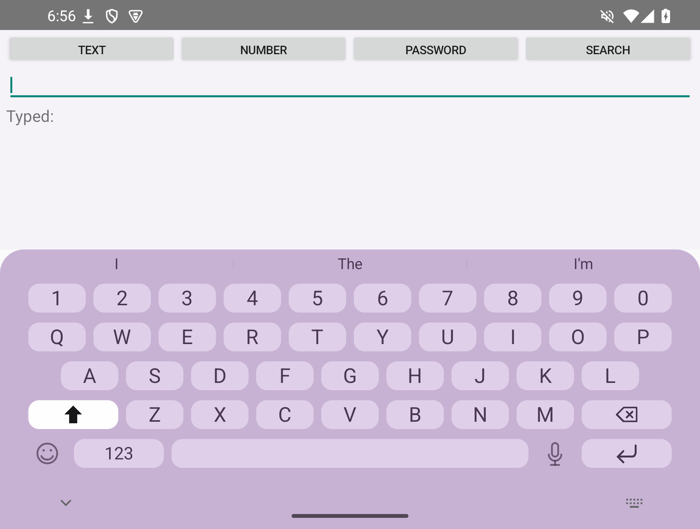
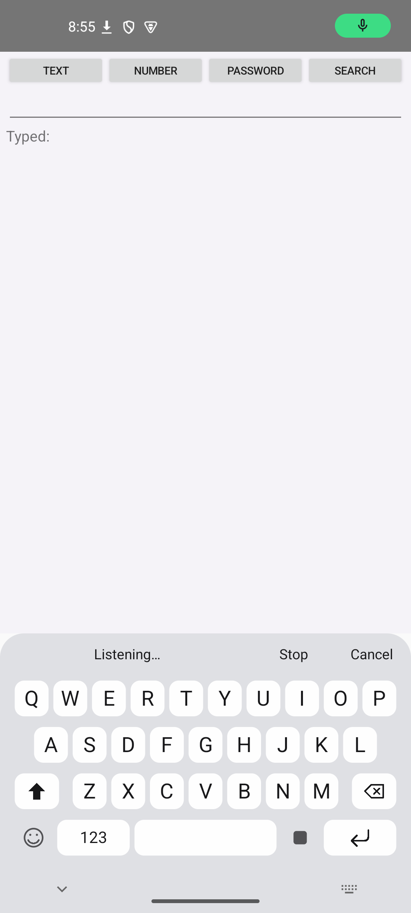
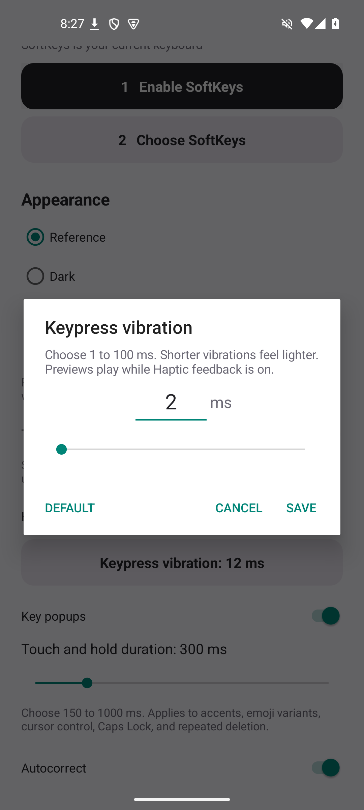
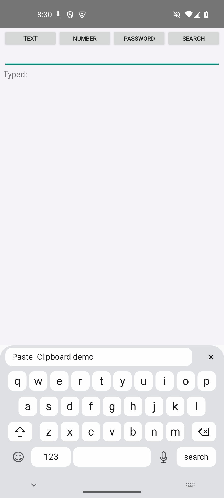

# SoftKeys

An iOS-inspired English keyboard for Android, with local autocorrect, glide typing, and layouts for phones and foldables.

[](https://github.com/gitcommit90/softkeys/actions/workflows/android.yml)

[Download the latest APK](https://github.com/gitcommit90/softkeys/releases/latest) | [Release notes](CHANGELOG.md) | [Development](docs/development.md)

SoftKeys runs on Android 8.0 and later. Text predictions stay on the device. Dictation uses your phone's speech recognition service. The current release is **1.10**.

## Appearance

The default Reference theme uses light gray with white keys on narrow displays and lavender on wide displays. Both layouts use continuous rows with one space bar. Wide displays include a dedicated number row by default. Enter sits at the far right of the bottom row, with the microphone beside Space. Dark, Lavender, and System themes are also available.

<table>
  <tr>
    <th>Phone</th>
    <th>Wide display</th>
  </tr>
  <tr>
    <td width="38%"></td>
    <td width="62%"></td>
  </tr>
</table>

The captures show the 1.5 Reference layout on narrow and wide displays. They use a sample editor and contain no personal messages.

## Install

1. Download `SoftKeys-1.10.apk` from [Releases](https://github.com/gitcommit90/softkeys/releases/latest). GitHub sign-in and access to this private repository are required.
2. Open the APK on your Android device and allow installation from your browser or file manager if Android asks.
3. Open SoftKeys, choose **Enable SoftKeys**, then choose **Choose SoftKeys**.
4. Open a text field to start typing, or use the sample field in the SoftKeys app.

The release uses the same signing certificate as the previous signed SoftKeys downloads, so it can update those installations. No developer account is needed for direct installation. The release includes a SHA-256 checksum for the APK.

## Typing

| Feature | How to use it |
| --- | --- |
| Autocorrect | Type a word and enter a space or punctuation. The highlighted middle suggestion shows the word that will be inserted. Tap your own spelling, shown in quotes on the left, to keep it. Press Backspace immediately after a correction to restore the original spelling. |
| Glide typing | Slide through the letters of a word and lift to insert it. Tap a suggestion to choose another match. Press Backspace right after a glide to remove the whole word. The trail is a translucent stroke that is widest under your finger and narrows behind it. |
| Numbers and symbols | Tap 123, type, and enter a space to return to the letters. An apostrophe also returns to the letters. To type one symbol, hold 123, slide to the symbol, and lift. |
| Cursor control | Hold Space, then drag left or right. Drag up or down to move between lines in multiline editors. |
| Accents | Hold a letter, then choose a variant. |
| Capitals | Tap Shift for uppercase. Double-tap or hold Shift for Caps Lock. |
| Repeated deletion | Hold Backspace. It removes characters first and then whole words. |
| Clipboard suggestion | Tap the Paste chip above the keys to insert recently copied text. Tap its close button to dismiss it. |
| Emoji | Open the emoji picker for categories, search, and recent selections. Drag sideways to slide between pages. Hold an emoji with a dot below it for variants. |
| Dictation | Tap the microphone to speak while SoftKeys stays visible. Tap Stop or the microphone again to finish, or Cancel to discard the request. |

Autocorrect, suggestions, and glide decoding use a bundled English dictionary with contractions, common names, and common texting and technology words. Autocorrect uses where each tap landed, so a tap near the edge of a key can be read as the neighboring letter. Recognized words, acronyms, and mixed case text are preserved. Short words that the dictionary does not hold are changed only when the evidence is strong. URL and path syntax stays literal, while ordinary search words can be corrected.

SoftKeys stops correcting a word after you keep your own spelling. Restoring a spelling with Backspace keeps that word until the keyboard restarts. Restoring it a second time, or tapping your spelling in the suggestions, saves the word on the phone. Saved words also appear in suggestions and glide results.

A glide or a chosen suggestion adds a space after the word. A punctuation mark typed next replaces that space, and a glide after punctuation starts with a space.

Glide entry and suggestions remain available in email fields and recognized terminal editors. Automatic word replacement stays off in those fields. Password fields keep predictions disabled. Recognized terminal command fields marked as visible passwords have a specific exception unless their hints identify a password or secret.

## Dictation

The first microphone tap asks for audio permission. After granting access, return to your text field and tap the microphone again to start. You can also grant permission through Microphone access in SoftKeys settings.

Dictation stays active through pauses until you tap Stop or the microphone again. There is no session timer. Listening status and partial text appear above the keys, and Stop inserts the accumulated transcript into the original field. Cancel discards the session. Typing, moving the cursor, hiding the keyboard, or changing fields cancels dictation. Password and numeric fields do not support dictation.

On Android 13 and later, SoftKeys supplies a continuous audio stream to providers that support segmented recognition. Older Android versions and providers that end each request use automatically repeated recognition requests, which can have brief gaps between requests. Speech recognition depends on the service installed on your phone and its available English (US) language support. The service may use the network or process audio locally. SoftKeys keeps its own keyboard visible and does not open the provider's voice keyboard.



## Settings

Open SoftKeys to change appearance and typing preferences. The app has separate switches for autocorrect, glide typing, clipboard suggestions, automatic capitalization, double-space periods, haptic feedback, and key popups. **Reset learned words** removes the words that SoftKeys saved after you kept your own spelling.

Open **Keypress vibration** to choose a duration from 1 to 100 ms using a slider or an exact number, including 2 ms. Moving the slider previews the vibration when Haptic feedback is on. Save keeps the value, Cancel preserves the previous value, and Default selects the existing 12 ms default. Hold feedback adjusts with the chosen duration.

Clipboard suggestions use the time the text was copied and expire after two minutes. A suggestion disappears when pasted, dismissed, or edited text is entered. The same item stays dismissed until a new item is copied, even when another editor opens. Suggestions stay out of password fields and do not preview clips marked sensitive by the copying app. No clipboard history is saved, and dismissing a suggestion leaves Android's clipboard unchanged.

The **Tablet number row** switch controls the dedicated digits on wide displays, including unfolded phones. It is enabled by default and does not add a row to narrow phone layouts. The row stays visible when switching between letters and symbols.

Touch and hold duration defaults to **300 ms**. Set it from 150 to 1000 ms in 25 ms steps. The setting applies to accents, emoji variants, cursor control, held Shift, and repeated deletion. Turning off automatic capitalization leaves manual Shift and Caps Lock available.

<details>
<summary>View the vibration and clipboard controls</summary>

<p>
  
  
</p>

</details>

## Privacy and permissions

SoftKeys does not send typed text over the network, and it does not save what you type. The exception is the list of learned words, which holds single words that you chose to keep after a correction. The list is saved on the phone, never includes text from password fields, and can be cleared with Reset learned words. Keyboard settings and recent emoji selections are also saved locally. The keyboard reads nearby editor text to provide suggestions and corrections. When Clipboard suggestions is enabled, it also reads recent copied text for the Paste chip and keeps the eligible item only in memory until it is dismissed or expires. This feature does not save a clipboard history.

The app requests Android's normal `VIBRATE` permission for haptic feedback and optional `RECORD_AUDIO` permission for dictation. It has no network, contacts, or storage permissions. Dictation sends microphone audio to the phone's speech recognition service, which may send it to its provider. SoftKeys does not save microphone audio or transcripts to files.

## Build

Use Java 17, Android SDK platform 36, and the included Gradle wrapper. Set `ANDROID_HOME`, or put your SDK path in an untracked `local.properties` file.

```sh
git clone https://github.com/gitcommit90/softkeys.git
cd softkeys
./gradlew :app:assembleRelease --console=plain
```

The unsigned APK is written to `app/build/outputs/apk/release/app-release-unsigned.apk`. GitHub Actions checks the unsigned release build. Manual workflow runs can also upload the unsigned APK when Actions storage is available. Installable signed updates are attached to Releases. Signing keys stay outside the repository and GitHub Actions.

See [Development](docs/development.md) for the source layout, the sample editor, and release guidance.

## Current limits

Glide decoding and autocorrect judge each word alone. They do not use the words before it, so words with the same or nearly the same path, such as "to" and "too" or "has" and "had", are chosen by how common they are. On recorded swipes from the public How We Swipe dataset, the first choice matched the intended word in about 84 of 100 swipes, and the intended word was among the three choices in about 92 of 100. Cursor control depends on the editor's handling of Android arrow keys. Custom editors can behave differently from standard Android text fields.

Emoji use the device's Android font, so artwork and available characters depend on Android. Apple emoji artwork is not included. Haptic feedback depends on physical device hardware and system restrictions.

For 1.9, the dictionary engine was measured with `bench/TypingBench.java` on simulated taps and on recorded human swipes. An emulator review on a narrow phone layout covered autocorrect, restoring a spelling, the return to letters after numbers and punctuation, sliding from 123, glide spacing and capitalization, margin taps, and held Backspace. Wide layouts, physical devices, Chrome, and Terminus were not reviewed for 1.9.

## Data and licenses

The English dictionary is derived from Hermit Dave's [FrequencyWords English 2018 list](https://github.com/hermitdave/FrequencyWords), based on OpenSubtitles 2018. It retains lowercase ASCII words and contractions up to 26 characters, with tab-separated counts. The modified dictionary is distributed under [CC BY-SA 4.0](app/src/main/assets/licenses/CC-BY-SA-4.0.txt). The source list splits contractions at the apostrophe, so `lexicon.tsv` adds contractions with estimated counts, capital letters for common names, and common texting and technology words. It also removes the leftover fragments and some misspellings. `lexicon.tsv` was written for SoftKeys.

Emoji names and sequences come from [Unicode Emoji 16.0](https://www.unicode.org/Public/emoji/16.0/emoji-test.txt), under the [Unicode License v3](app/src/main/assets/licenses/Unicode-3.0.txt). Attribution and notices are bundled in [NOTICE.txt](app/src/main/assets/licenses/NOTICE.txt) and are available in the app's license screen.
