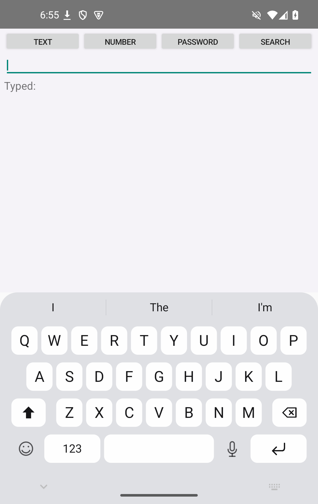
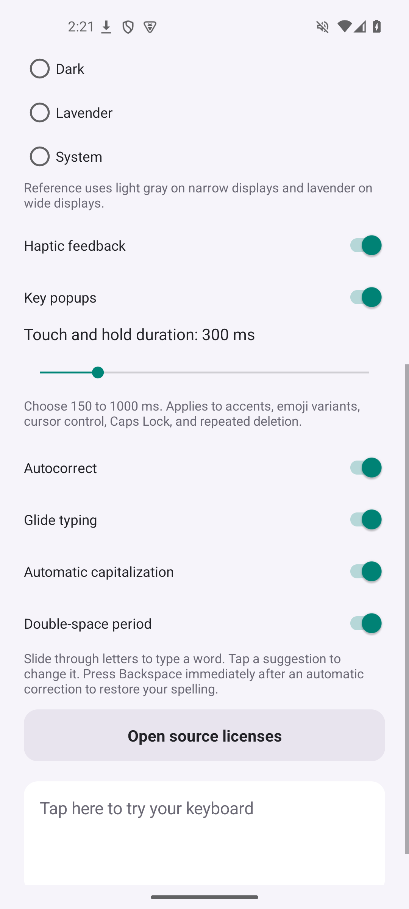
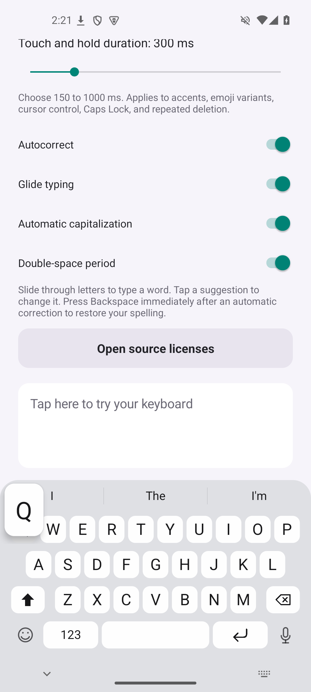

# SoftKeys

An iOS-inspired English keyboard for Android, with local autocorrect, glide typing, and layouts for phones and foldables.

[](https://github.com/gitcommit90/softkeys/actions/workflows/android.yml)

[Download the latest APK](https://github.com/gitcommit90/softkeys/releases/latest) | [Release notes](CHANGELOG.md) | [Development](docs/development.md)

SoftKeys runs on Android 8.0 and later. Typing and predictions stay on the device, and the app has no network permission. The current release is **1.5**.

## Appearance

The default Reference theme uses light gray with white keys on narrow displays and lavender on wide displays. Both layouts use continuous rows with one space bar. Wide displays include a dedicated number row by default. Enter sits at the far right of the bottom row, with the microphone beside Space. Dark, Lavender, and System themes are also available.

<table>
  <tr>
    <th>Phone</th>
    <th>Wide display</th>
  </tr>
  <tr>
    <td width="38%"></td>
    <td width="62%"></td>
  </tr>
</table>

The captures show the 1.5 Reference layout on narrow and wide displays. They use a sample editor and contain no personal messages.

## Install

1. Download `SoftKeys-1.5.apk` from [Releases](https://github.com/gitcommit90/softkeys/releases/latest). GitHub sign-in and access to this private repository are required.
2. Open the APK on your Android device and allow installation from your browser or file manager if Android asks.
3. Open SoftKeys, choose **Enable SoftKeys**, then choose **Choose SoftKeys**.
4. Open a text field to start typing, or use the sample field in the SoftKeys app.

The release uses the same signing certificate as the previous signed SoftKeys downloads, so it can update those installations. No developer account is needed for direct installation. The release includes a SHA-256 checksum for the APK.

## Typing

| Feature | How to use it |
| --- | --- |
| Autocorrect | Type a word and enter a space or punctuation. Press Backspace immediately after a correction to restore the original spelling. |
| Glide typing | Slide through the letters of a word and lift to insert it. Tap a suggestion to choose another match. The trail is warm white. |
| Cursor control | Hold Space, then drag left or right. Drag up or down to move between lines in multiline editors. |
| Accents | Hold a letter, then choose a variant. |
| Capitals | Tap Shift for uppercase. Double-tap or hold Shift for Caps Lock. |
| Repeated deletion | Hold Backspace. |
| Emoji | Open the emoji picker for categories, search, and recent selections. Swipe to change pages. Hold an emoji with a dot below it for variants. |
| Voice input | Tap the microphone to switch to an enabled voice keyboard. Android opens the keyboard picker if none is enabled. |

Autocorrect, suggestions, and glide decoding use a bundled English dictionary. Recognized words, acronyms, and mixed case text are preserved. URL and path syntax stays literal, while ordinary search words can be corrected.

Glide entry and suggestions remain available in email fields and recognized terminal editors. Automatic word replacement stays off in those fields. Password fields keep predictions disabled. Recognized terminal command fields marked as visible passwords have a specific exception unless their hints identify a password or secret.

## Settings

Open SoftKeys to change appearance and typing preferences. The app has separate switches for autocorrect, glide typing, automatic capitalization, double-space periods, haptic feedback, and key popups.

The **Tablet number row** switch controls the dedicated digits on wide displays, including unfolded phones. It is enabled by default and does not add a row to narrow phone layouts. The row stays visible when switching between letters and symbols.

Touch and hold duration defaults to **300 ms**. Set it from 150 to 1000 ms in 25 ms steps. The setting applies to accents, emoji variants, cursor control, held Shift, and repeated deletion. Turning off automatic capitalization leaves manual Shift and Caps Lock available.

<details>
<summary>View the 1.4 settings and key popup</summary>

<p>
  
  
</p>

</details>

## Privacy and permissions

SoftKeys does not save typed text or send it over the network. Keyboard settings and recent emoji selections are saved locally. The keyboard reads nearby editor text to provide suggestions and corrections.

The app requests only Android's normal `VIBRATE` permission for haptic feedback. It has no network, microphone, contacts, or storage permissions. Voice recognition is handled by the voice keyboard selected through Android.

## Build

Use Java 17, Android SDK platform 36, and the included Gradle wrapper. Set `ANDROID_HOME`, or put your SDK path in an untracked `local.properties` file.

```sh
git clone https://github.com/gitcommit90/softkeys.git
cd softkeys
./gradlew :app:assembleRelease --console=plain
```

The unsigned APK is written to `app/build/outputs/apk/release/app-release-unsigned.apk`. GitHub Actions checks the unsigned release build. Manual workflow runs can also upload the unsigned APK when Actions storage is available. Installable signed updates are attached to Releases. Signing keys stay outside the repository and GitHub Actions.

See [Development](docs/development.md) for the source layout, the sample editor, and release guidance.

## Current limits

Glide decoding is an initial implementation and can misread gestures. Cursor control depends on the editor's handling of Android arrow keys. Custom editors can behave differently from standard Android text fields.

Emoji use the device's Android font, so artwork and available characters depend on Android. Apple emoji artwork is not included. Haptic feedback depends on physical device hardware and system restrictions.

The 1.4 release build, signature, alignment, and download were checked. Emulator captures were reviewed for settings, popups, and cursor mode. Physical vibration and Chrome/Terminus behavior on the user's device have not been verified. No automated test suite was run for 1.4.

## Data and licenses

The English dictionary is derived from Hermit Dave's [FrequencyWords English 2018 list](https://github.com/hermitdave/FrequencyWords), based on OpenSubtitles 2018. It retains lowercase ASCII words and contractions up to 26 characters, with tab-separated counts. The modified dictionary is distributed under [CC BY-SA 4.0](app/src/main/assets/licenses/CC-BY-SA-4.0.txt).

Emoji names and sequences come from [Unicode Emoji 16.0](https://www.unicode.org/Public/emoji/16.0/emoji-test.txt), under the [Unicode License v3](app/src/main/assets/licenses/Unicode-3.0.txt). Attribution and notices are bundled in [NOTICE.txt](app/src/main/assets/licenses/NOTICE.txt) and are available in the app's license screen.
